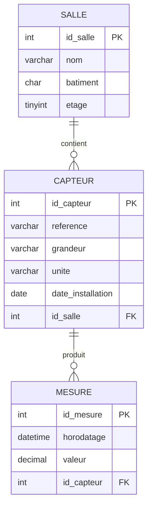

# Bases de données et SQL — Cours

**Matière :** Informatique — **Modules :** E4 (conception), E5 (exploitation), E6 (protection des données)
**Dernière mise à jour :** 02/10/2026
**Statut :** fichier évolutif — la partie « Protéger » (comptes, droits, injections SQL) est annoncée mais pas encore traitée en cours
**Fichier associé :** `supervision.sql` (script de création de la base d'exercice, à placer dans le même dossier)

---

## 1. Pourquoi une base de données ?

### Le problème posé

On doit stocker les mesures de capteurs : **57 600 mesures par jour**. *(Ordre de grandeur cohérent avec 40 capteurs envoyant une mesure par minute : $40 \times 1\,440 = 57\,600$.)* La solution doit permettre de :

- gérer **40 capteurs qui envoient leurs mesures en même temps** ;
- **retrouver une valeur en une seule requête** ;
- laisser le site web **consulter** les données, mais **seul l'administrateur peut les modifier**.

Un simple fichier CSV ne sait pas faire tout cela : on utilise donc une **base de données**.

### Comparaison CSV / base de données

| Besoin | Fichier CSV | Base de données |
|---|---|---|
| Écriture simultanée | Risque de **corruption** | Accès concurrents **gérés** |
| Recherche parmi 1 million de lignes | Lecture de **tout** le fichier | **Index** : réponse immédiate |
| Données cohérentes | **Aucun contrôle** | Types et contraintes **vérifiés** |
| Contrôle d'accès | Droits du fichier seulement | Droits **par compte et par table** |

### Les 4 étapes du chapitre

1. **Comprendre** le rôle d'un SGBDR (table, ligne, colonne, clé).
2. **Construire** (`CREATE TABLE`, `INSERT INTO`, `UPDATE`...).
3. **Interroger** (`SELECT`, `WHERE`, `ORDER BY`...).
4. **Protéger** (comptes et droits, injections SQL).

---

## 2. Comprendre : le SGBD et son fonctionnement

Un **SGBD** (Système de Gestion de Base de Données) est un logiciel serveur qui **répond aux requêtes de ses clients**.

- **Clients possibles :** terminal MariaDB, script Python, site web, API, ESP32...
- **Fonctionnement :** le client envoie une **requête SQL** au serveur MariaDB sur le **port TCP 3306**. Le serveur exécute la requête, lit ou écrit les données **sur le disque**, et renvoie la réponse.

```
Client (Python, site web, ESP32...)  ──requête SQL (TCP 3306)──►  Serveur MariaDB  ◄──►  Disque
```

**SGBD relationnels (SGBDR) courants :** MariaDB, MySQL, PostgreSQL, SQL Server, Oracle. **SQLite** est un cas à part : il est **embarqué**, c'est-à-dire sans serveur (la base est un simple fichier lu directement par le programme).

### Vocabulaire d'une table

| Terme | Définition |
|---|---|
| **Table** | Un tableau de données sur un sujet (ex. les capteurs) |
| **Attribut** (colonne) | Une propriété avec un **type** (ex. `reference`, `valeur`) |
| **Enregistrement** (ligne) | Un objet précis (ex. le capteur `DHT22-001`) |
| **Clé primaire** | Identifie **chaque ligne** de façon unique |
| **Clé étrangère** | Colonne qui **pointe vers une autre table** (elle contient la clé primaire d'une ligne de l'autre table) |

### Les 4 familles d'instructions SQL

| Famille | Rôle | Instructions |
|---|---|---|
| **LDD** — Langage de Définition de Données | Créer et modifier la **structure** | `CREATE`, `ALTER`, `DROP` |
| **LID** — Langage d'Interrogation de Données | **Lire** les données | `SELECT` |
| **LMD** — Langage de Manipulation de Données | **Ajouter, modifier, supprimer** des lignes | `INSERT`, `UPDATE`, `DELETE` |
| **LCD** — Langage de Contrôle de Données | Gérer les **comptes et les droits** | `GRANT`, `REVOKE` |

---

## 3. La base d'exercice « supervision »

Mesures de capteurs installés dans les salles d'un lycée. Trois tables reliées par des clés étrangères :



| Table | Clé primaire | Clé étrangère | Remarque |
|---|---|---|---|
| `salle` | `id_salle` | — | `nom` unique ; `etage` vaut 0 par défaut |
| `capteur` | `id_capteur` | `id_salle` → `salle` | `reference` unique ; `id_salle` peut être **vide** (capteur non installé) |
| `mesure` | `id_mesure` | `id_capteur` → `capteur` | une mesure appartient obligatoirement à un capteur |

Les contraintes `NOT NULL`, `UNIQUE`, `DEFAULT`, `PRIMARY KEY` et `FOREIGN KEY` sont les « contrôles » que le CSV n'offre pas : la base **refuse** une donnée qui les viole.

**Chargement du script** (dans le terminal) :
```bash
sudo mariadb < supervision.sql     # charge la base
sudo mariadb                       # ouvre le client SQL
```

> **Note de Claude :** dans le brouillon, le script avait deux défauts de copier-coller : (1) toutes les lignes étaient collées en une seule, avec des commentaires `--` au début — or un commentaire SQL `--` va jusqu'à la **fin de la ligne**, donc tout le reste aurait été ignoré ; (2) la référence du capteur n° 5 était écrite `'D*HT22-003'` (un astérisque parasite, venu de la mise en forme) au lieu de `'DHT22-003'`. Avec cette coquille, les requêtes C2 et C4 ne renverraient pas les lignes attendues. Le fichier `supervision.sql` fourni avec ce cours est la version corrigée et correctement mise en forme.

---

## 4. Exercice corrigé

### Partie A — Structure (LDD)

**A1. Charger le script, afficher la liste des tables et la structure de `mesure`.**
```sql
USE supervision;
SHOW TABLES;
DESCRIBE mesure;
```

**A2. Créer la table `alerte`** (`id_alerte` auto-incrémenté et clé primaire ; `horodatage` obligatoire ; `niveau` 10 caractères max, obligatoire, défaut `'info'` ; `message` 100 caractères max, obligatoire ; `id_capteur` obligatoire, clé étrangère vers `capteur`) :
```sql
CREATE TABLE alerte (
    id_alerte   INT AUTO_INCREMENT PRIMARY KEY,
    horodatage  DATETIME     NOT NULL,
    niveau      VARCHAR(10)  NOT NULL DEFAULT 'info',
    message     VARCHAR(100) NOT NULL,
    id_capteur  INT          NOT NULL,
    CONSTRAINT fk_alerte_capteur
        FOREIGN KEY (id_capteur) REFERENCES capteur(id_capteur)
);
```

**A3. Ajouter une colonne `capacite` (entier) à `salle`, puis vérifier.**
```sql
ALTER TABLE salle ADD capacite INT;
DESCRIBE salle;
```

### Partie B — Manipulation (LMD)

**B1. Ajouter la salle B103, bâtiment B, étage 1.**
```sql
INSERT INTO salle (nom, batiment, etage) VALUES ('B103', 'B', 1);
```

**B2. Le capteur `SCD30-002` est installé au CDI le 5 octobre 2026 : mettre sa ligne à jour.** (Le CDI a l'identifiant 5.)
```sql
UPDATE capteur
SET id_salle = 5, date_installation = '2026-10-05'
WHERE reference = 'SCD30-002';
```
⚠️ **Ne jamais oublier le `WHERE`** dans un `UPDATE` : sans lui, **toutes** les lignes de la table seraient modifiées.

**B3. Enregistrer une alerte critique pour le capteur 3, le 28/09/2026 à 12 h : « CO2 supérieur à 1000 ppm ».**
```sql
INSERT INTO alerte (horodatage, niveau, message, id_capteur)
VALUES ('2026-09-28 12:00:00', 'critique', 'CO2 supérieur à 1000 ppm', 3);
```

**B4. Tenter de supprimer la salle B101. Relever le numéro de l'erreur et l'expliquer.**
```sql
DELETE FROM salle WHERE id_salle = 1;
```
→ **ERROR 1451** : la suppression est **refusée**, car **deux capteurs** (`DHT22-001` et `DHT22-002`) référencent encore la salle 1 par leur clé étrangère. C'est l'**intégrité référentielle** : la base empêche de supprimer une ligne « parent » tant que des lignes « enfants » en dépendent (sinon ces capteurs pointeraient vers une salle qui n'existe plus). Pour supprimer la salle, il faudrait d'abord déplacer ou supprimer ces capteurs.

**B5. Supprimer la mesure du capteur 5 relevée avant 9 h. Combien de lignes sont supprimées ?**
```sql
DELETE FROM mesure
WHERE id_capteur = 5 AND horodatage < '2026-09-28 09:00:00';
```
→ **1 ligne** supprimée (la mesure de 08:00 ; celle de 10:00 est conservée).

> **Avant la partie C**, on recharge le script pour retrouver les données d'origine : `sudo mariadb < supervision.sql` (il commence par `DROP DATABASE IF EXISTS supervision`, donc il repart d'une base propre).

### Partie C — Interrogation (LID)

**C1. Nom et bâtiment de toutes les salles, par ordre alphabétique du nom.** *(5 lignes : Atelier, B101, B102, C201, CDI)*
```sql
SELECT nom, batiment FROM salle ORDER BY nom;
```

**C2. Référence et date d'installation des capteurs de température.** *(3 lignes : DHT22-001, DS18B20-001, DHT22-003)*
```sql
SELECT reference, date_installation FROM capteur WHERE grandeur = 'temperature';
```

**C3. Horodatage et valeur des mesures du capteur 1 supérieures à 21 °C.** *(2 lignes : 12:00 → 22.50 et 14:00 → 23.00)*
```sql
SELECT horodatage, valeur FROM mesure WHERE id_capteur = 1 AND valeur > 21;
```
*(La mesure de 10:00 vaut exactement 21,0 : elle n'est **pas** retenue car `>` signifie « strictement supérieur ».)*

**C4. Référence et grandeur des capteurs dont la référence commence par DHT22.** *(3 lignes)*
```sql
SELECT reference, grandeur FROM capteur WHERE reference LIKE 'DHT22%';
```
`LIKE` fait une recherche par motif ; `%` remplace « n'importe quelle suite de caractères ».

**C5. Référence des capteurs installés dans aucune salle.** *(1 ligne : SCD30-002)*
```sql
SELECT reference FROM capteur WHERE id_salle IS NULL;
```
⚠️ On écrit `IS NULL` et **jamais** `= NULL` : `NULL` signifie « valeur inconnue/absente » et ne se compare pas avec `=`.

**C6. Les 3 mesures les plus élevées du capteur 3, de la plus forte à la plus faible.** *(1250.00, 980.00, 850.00)*
```sql
SELECT horodatage, valeur FROM mesure
WHERE id_capteur = 3
ORDER BY valeur DESC
LIMIT 3;
```

---

## 5. Aide-mémoire SQL

| Je veux... | J'écris... |
|---|---|
| Lire des colonnes | `SELECT col1, col2 FROM table` |
| Filtrer | `WHERE condition` (`=`, `>`, `<`, `LIKE`, `IS NULL`, `AND`, `OR`) |
| Trier | `ORDER BY col [ASC \| DESC]` |
| Limiter le nombre de lignes | `LIMIT n` |
| Ajouter une ligne | `INSERT INTO table (cols) VALUES (valeurs)` |
| Modifier | `UPDATE table SET col = valeur WHERE ...` |
| Supprimer des lignes | `DELETE FROM table WHERE ...` |
| Créer / modifier / supprimer une table | `CREATE TABLE` / `ALTER TABLE` / `DROP TABLE` |

## 6. À venir : « Protéger » (non traité en cours pour l'instant)

Ces deux notions sont annoncées dans le plan du chapitre ; ce qui suit est un simple aperçu à confirmer lors du cours.

- **Comptes et droits (LCD)** : on crée des comptes distincts et on ne donne à chacun que ce dont il a besoin (principe du **moindre privilège**). Cela répond à la contrainte de départ : *le site web peut consulter, seul l'administrateur peut modifier*. Exemple : un compte `site_web` avec `GRANT SELECT ON supervision.* TO ...`, et un compte administrateur avec tous les droits.
- **Injections SQL** : attaque où un utilisateur glisse du code SQL dans un champ de saisie (formulaire, paramètre d'URL) pour que le serveur l'exécute. La parade principale : ne jamais assembler une requête en collant du texte venant de l'utilisateur, mais utiliser des **requêtes préparées** (paramétrées).

## 7. Lexique

| Terme | Définition |
|---|---|
| SGBD / SGBDR | Logiciel qui gère une base de données (relationnelle pour SGBDR) |
| Requête | Instruction SQL envoyée au serveur |
| Index | Structure qui accélère les recherches |
| Intégrité référentielle | Garantie qu'une clé étrangère pointe toujours vers une ligne existante |
| NULL | Valeur absente ou inconnue |
