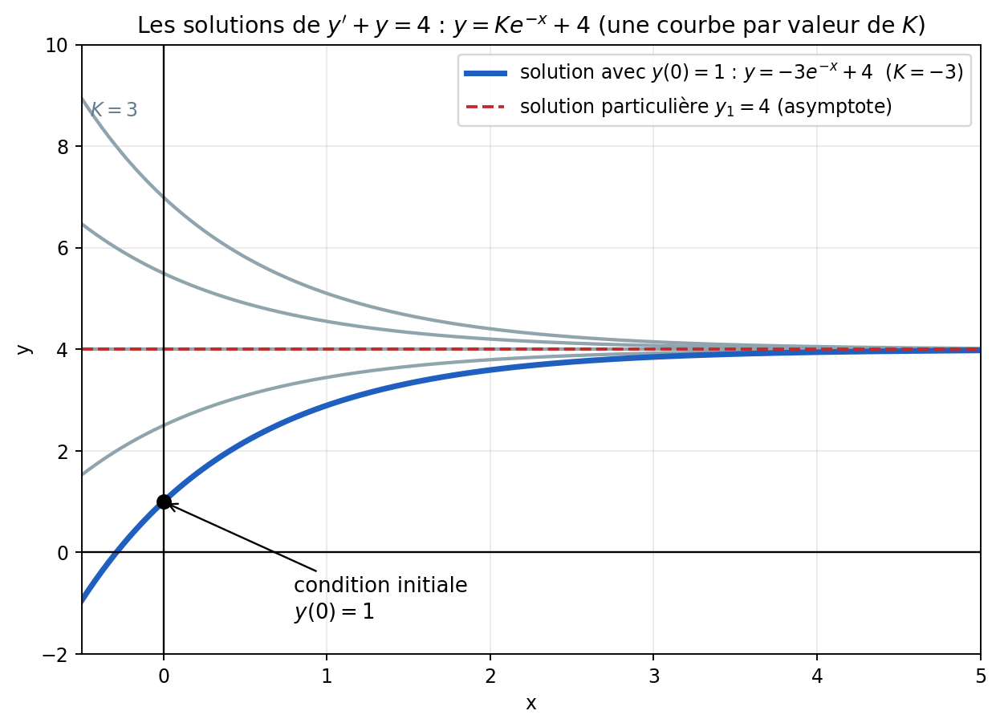
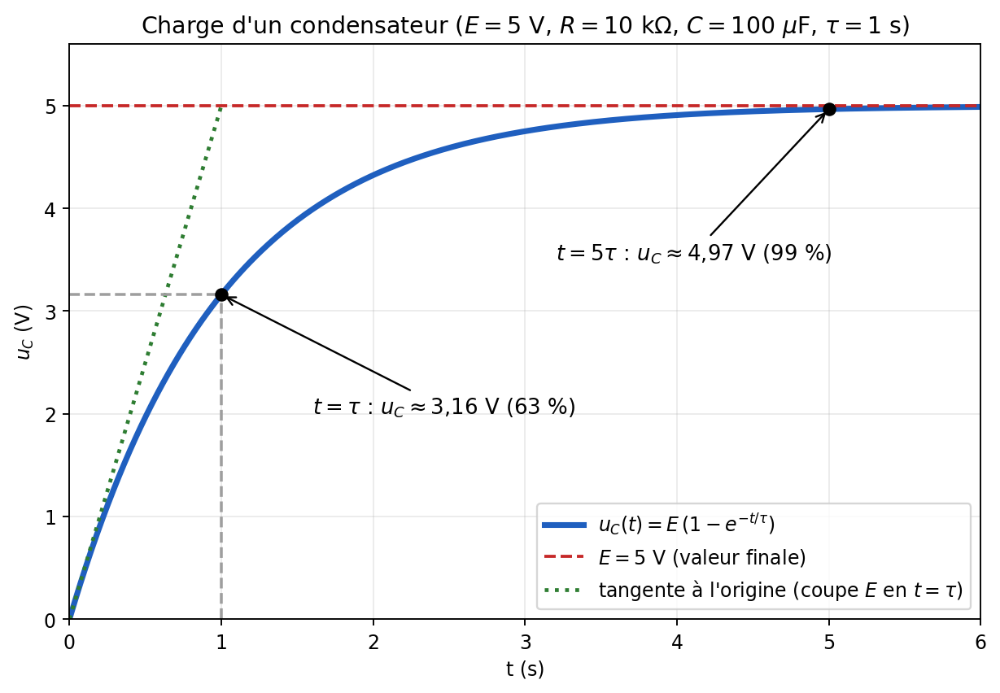

# Équations différentielles du premier ordre — Cours

**Matière :** Maths
**Dernière mise à jour :** 15/10/2026
**Statut :** fichier évolutif — à compléter à chaque nouveau cours
**Important :** ce fichier utilise des images. Garde le dossier `Equations-differentielles_images/` **à côté** de ce fichier `.md`.
**Prérequis (à relire si besoin) :** [[Derivation]] (dérivées de $x^n$ et de $e^{kx}$) · [[Exponentielle-et-Logarithme]]

> Ce cours est écrit pour quelqu'un qui part de zéro sur le sujet : chaque étape est expliquée, avec des exemples entièrement calculés. Les parties marquées « complément » ne sont pas dans tes notes mais étaient annoncées dans les objectifs du cours.

---

## 1. Introduction : c'est quoi, une équation différentielle ?

### 1.1 Une équation « normale » vs une équation différentielle

- Dans une équation **normale** comme $2x + 3 = 11$, l'inconnue est un **nombre** : on cherche $x = 4$.
- Dans une équation **différentielle** comme $y' + y = 4$, l'inconnue est une **fonction** $y(x)$ : on cherche une *courbe* ! Et l'équation relie la fonction $y$ à sa **dérivée** $y'$.

**Rappel essentiel :** la dérivée $y'$ mesure **la vitesse à laquelle $y$ varie**. Une équation différentielle dit donc : *« voilà comment ma grandeur évolue ; retrouve la grandeur elle-même »*.

### 1.2 Pourquoi s'y intéresser ?

Les équations différentielles décrivent **tout ce qui évolue dans le temps** : la charge d'un condensateur, la température d'un composant qui chauffe ou refroidit, la vitesse d'un moteur... Dans tous ces cas, on connaît une **règle de variation** (« ça monte d'autant plus vite que l'écart est grand ») et on veut en déduire **la valeur à chaque instant**.

### 1.3 Un premier exemple pour sentir le principe

Équation : $y' = 2y$. Elle dit : « la vitesse de variation de $y$ est le double de $y$ ». Quelle fonction a cette propriété ? Essayons $y(x) = e^{2x}$ :
$$y'(x) = 2e^{2x} = 2\,y(x) \quad ✓$$
La fonction $y = e^{2x}$ est **une solution**. (Et $y = 5e^{2x}$ aussi, et $y = -3e^{2x}$... on y reviendra.)

### 1.4 Objectifs du chapitre

1. Reconnaître une équation différentielle.
2. Résoudre l'**équation homogène** $a\,y' + b\,y = 0$.
3. Trouver une **solution particulière** selon la forme du second membre.
4. Écrire la **solution générale** et utiliser une **condition initiale**.
5. Utiliser la **méthode de Lagrange** (variation de la constante). *(complément, voir §8)*
6. Appliquer à la **charge d'un condensateur** (circuit RC). *(complément, voir §9)*

## 2. Vocabulaire

On étudie les équations de la forme :
$$(E) \qquad a\,y'(x) + b\,y(x) = h(x)$$
où $a$ et $b$ sont des **nombres** (avec $a \neq 0$) et $h$ est une fonction connue.

| Terme | Signification |
|---|---|
| **Inconnue** | La fonction $y$ (on cherche $y(x)$ pour tout $x$) |
| **Premier ordre** | La dérivée la plus haute qui apparaît est $y'$ (pas de $y''$) |
| **Second membre** | La fonction $h(x)$, à droite du signe $=$ |
| **Équation homogène** $(E_0)$ | L'équation où l'on remplace $h(x)$ par $0$ : $a\,y' + b\,y = 0$ |
| **Solution particulière** $y_1$ | **Une** solution de $(E)$, n'importe laquelle, la plus simple possible |
| **Solution générale** | **Toutes** les solutions de $(E)$, écrites d'un coup avec une constante $K$ |
| **Condition initiale** | Une valeur imposée, par exemple $y(0) = 1$, qui sert à trouver $K$ |

## 3. Un réflexe à acquérir : vérifier qu'une fonction est solution

Pour savoir si une fonction est solution, on **remplace** dans l'équation et on regarde si l'égalité est vraie.

*Exemple :* $y(x) = -3e^{-x} + 4$ est-elle solution de $y' + y = 4$ ?
- $y'(x) = -3 \times (-1)e^{-x} = 3e^{-x}$
- $y' + y = 3e^{-x} + (-3e^{-x} + 4) = 4$ ✓ Oui.

C'est aussi le meilleur moyen de **contrôler ses calculs** à la fin d'un exercice.

---

## 4. Étape 1 : résoudre l'équation homogène

On résout $(E_0)$ : $a\,y' + b\,y = 0$ (on remplace le second membre $h(x)$ par $0$).

### 4.1 Pourquoi une exponentielle ?

On réécrit : $y' = -\dfrac{b}{a}\,y$. Il faut donc une fonction **dont la dérivée est proportionnelle à elle-même**. Or c'est exactement ce que fait l'exponentielle : $(e^{rx})' = r\,e^{rx}$.

**L'astuce de l'équation caractéristique.** On cherche une solution de la forme $y = e^{rx}$. Alors $y' = r\,e^{rx}$ et, en remplaçant :
$$a\,r\,e^{rx} + b\,e^{rx} = 0 \;\Longleftrightarrow\; (a\,r + b)\,e^{rx} = 0$$
Comme $e^{rx}$ n'est **jamais nul**, il faut $a\,r + b = 0$. C'est l'**équation caractéristique** (dans tes notes : « on remplace $y'$ par $r$ et $y$ par $1$ »).

### 4.2 Le résultat à retenir

$$a\,r + b = 0 \;\Rightarrow\; r_0 = -\frac{b}{a} \qquad\text{et}\qquad y_0(x) = K\,e^{r_0 x}\quad (K \in \mathbb{R})$$

> **Note de Claude :** dans le brouillon, la solution de l'équation caractéristique était écrite « $r_0 = -b/1$ » dans le cadre général. C'est une coquille : c'est bien $r_0 = -\dfrac{b}{a}$ (le brouillon l'écrit correctement dans l'exemple qui suit).

**Que veut dire le $K$ ?** C'est un nombre **quelconque** : il y a donc une **infinité** de solutions (une par valeur de $K$). C'est normal : l'équation donne la « forme » de l'évolution, mais pas le point de départ. La condition initiale (étape 4) servira à choisir **la** bonne.

### 4.3 Exemples

| Équation homogène | $a$ | $b$ | $r_0 = -\dfrac{b}{a}$ | Solutions $y_0$ |
|---|---|---|---|---|
| $y' + y = 0$ | 1 | 1 | $-1$ | $K e^{-x}$ |
| $2y' - y = 0$ | 2 | $-1$ | $\dfrac{1}{2}$ | $K e^{x/2}$ |
| $2y' - 10y = 0$ | 2 | $-10$ | $5$ | $K e^{5x}$ |
| $3y' + 6y = 0$ | 3 | 6 | $-2$ | $K e^{-2x}$ |

**Attention au signe** : $r_0 = -\dfrac{b}{a}$. Quand $b$ est négatif (ex. $b = -1$), $-b$ devient positif.

*(Dans le brouillon, l'exemple « $2y'(x) - y(x) = x^2$ » donne $a = 2$, $b = -1$, $h(x) = x^2$ ; l'équation homogène est $2y' - y = 0$, avec $r_0 = \frac{1}{2}$ et $y_0 = K e^{x/2}$ : ✓.)*

---

## 5. Étape 2 : trouver une solution particulière $y_1$

On reprend maintenant l'équation **complète** $(E)$ (et non plus $(E_0)$). On cherche **une** fonction $y_1$ qui la vérifie.

**Le principe :** la forme de $y_1$ dépend de la forme du second membre $h(x)$. On devine la **forme** de la solution (avec des lettres $A$, $B$, $C$... à la place des nombres) et on **détermine ces lettres** en remplaçant dans l'équation. C'est la méthode des **coefficients à identifier**.

### 5.1 Les trois cas

| Cas | Si $h(x)$ est... | Alors on cherche $y_1$ de la forme... |
|---|---|---|
| **1** | un **polynôme** $P_n(x)$ de degré $n$ | si $b \neq 0$ : un polynôme $\varphi_n(x)$ **du même degré** ; si $b = 0$ : $x\,\varphi_n(x)$ |
| **2** | $P_n(x)\,e^{\lambda x}$ | si $\lambda \neq r_0$ : $\varphi_n(x)\,e^{\lambda x}$ ; si $\lambda = r_0$ : $x\,\varphi_n(x)\,e^{\lambda x}$ |
| **3** | $A\cos(px) + B\sin(px)$ | $C\cos(px) + D\sin(px)$ |

**Détails de notation :**
- $P_n(x)$ : un polynôme de **degré $n$**, de la forme $a_n x^n + \dots + a_1 x + a_0$. Pour trouver $n$, on regarde la plus grande puissance de $x$ dans $h(x)$.
- $\varphi_n(x)$ : un **polynôme inconnu** du même degré $n$. *(Le brouillon note « phi, un logo qui ressemble à un trident » : selon les cours, ce polynôme s'écrit $\varphi$ (phi) ou $\psi$ (psi, qui a la forme d'un trident). C'est simplement un nom pour « polynôme de degré $n$ à coefficients inconnus ».)*
- Exemples de $\varphi_n$ : $\varphi_0(x) = A$ ; $\varphi_1(x) = Ax + B$ ; $\varphi_2(x) = Ax^2 + Bx + C$.

> **Note de Claude (notation) :** attention à ne pas confondre le **$b$ minuscule** (le coefficient de l'équation $a\,y' + b\,y$) avec le **$B$ majuscule** (un coefficient inconnu du polynôme $Ax^2 + Bx + C$). Dans le brouillon, « si $B \neq 0$ » et « si $B = 0$ » désignent en réalité le **$b$ minuscule** de l'équation.

### 5.2 Pourquoi les cas « spéciaux » (multiplier par $x$) ?

Quand on devine une forme qui est **déjà une solution de l'équation homogène**, elle donne $0$ quand on la remplace dans $(E)$ : elle ne pourra jamais égaler un second membre non nul. Il faut alors « changer de forme » en multipliant par $x$.

*Exemple (cas 2, $\lambda = r_0$) :* si on essaie $y_1 = A e^{\lambda x}$ avec $\lambda = r_0$, alors $a\,y_1' + b\,y_1 = A(a\lambda + b)e^{\lambda x} = 0$ car $a\lambda + b = 0$ : impossible d'obtenir $e^{\lambda x}$. D'où $x\,e^{\lambda x}$.

*(Le cas 1 n'est d'ailleurs que le cas 2 avec $\lambda = 0$ : $b = 0$ revient à $r_0 = 0 = \lambda$.)*

### 5.3 Comment reconnaître le cas ? (exemples du cours)

| Équation | $h(x)$ | Cas |
|---|---|---|
| $y' - y = x\,e^{x}$ | $P_1(x) e^{\lambda x}$ avec $P_1(x) = x$ et $\lambda = 1$ | **Cas 2** ($r_0 = 1 = \lambda$ : version avec $x$ en plus) |
| $2y' - 10y = \cos(2x)$ | $A\cos(px) + B\sin(px)$ avec $A = 1$, $B = 0$, $p = 2$ | **Cas 3** |
| $2y' - 10y = 1$ | $1 = P_0(x)$, polynôme de degré 0 | **Cas 1** |

> **Note de Claude :** dans le brouillon, ces exemples sont écrits « $2y - 10y$ » sans le signe prime. Vu les calculs qui suivent dans le cours, l'équation étudiée est bien $2y' - 10y$ (avec $a = 2$ et $b = -10$).

---

### 5.4 Exemple complet n°1 (cas 1) : $2y' - 10y = x^2 - 1$

Ici $a = 2$, $b = -10$ (donc $b \neq 0$), $h(x) = x^2 - 1$ est un polynôme de **degré 2**.

> **Note de Claude :** dans le brouillon, l'énoncé est écrit une fois « $2y' + 10y = x^2 - 1$ ». Tous les calculs et le résultat final du brouillon correspondent à **$2y' - 10y$** (avec un moins) : c'est cette version que je traite ici.

**Étape 1 — homogène :** $2r - 10 = 0$ donc $r_0 = 5$ et $y_0 = K e^{5x}$.

**Étape 2 — solution particulière.** Cas 1, $b \neq 0$ : on cherche un polynôme de degré 2 :
$$y_p(x) = Ax^2 + Bx + C \qquad\text{donc}\qquad y_p'(x) = 2Ax + B$$
*(Rappel : la dérivée de $A x^n$ est $A \times n \times x^{n-1}$ ; la dérivée d'une constante est $0$.)*

On remplace dans l'équation $2y_p' - 10y_p = x^2 - 1$ :
$$2(2Ax + B) - 10(Ax^2 + Bx + C) = x^2 - 1$$
On développe, puis on **regroupe par puissances de $x$** :
$$4Ax + 2B - 10Ax^2 - 10Bx - 10C = \underbrace{-10A}_{\text{devant }x^2}\,x^2 + \underbrace{(4A - 10B)}_{\text{devant }x}\,x + \underbrace{(2B - 10C)}_{\text{constante}}$$

> **Note de Claude :** dans le brouillon, la ligne intermédiaire était écrite « $2(Ax + B) - 10(Ax^2 + Bx + C)$ » : il manque le facteur 2 dans la dérivée (la dérivée de $Ax^2 + Bx + C$ est $2Ax + B$, pas $Ax + B$). La ligne suivante du brouillon, « $4Ax + 2B - 10Ax^2 - \dots$ », est en revanche bien correcte.

**Identification.** Deux polynômes sont égaux quand leurs coefficients sont égaux, puissance par puissance. On compare avec $x^2 - 1 = 1\cdot x^2 + 0\cdot x + (-1)$ (« $x$ est multiplié par 0 car il n'existe pas dans le second membre ») :

| Puissance | Côté gauche | Côté droit | Équation |
|---|---|---|---|
| $x^2$ | $-10A$ | $1$ | $-10A = 1 \Rightarrow A = -\dfrac{1}{10} = -0{,}1$ |
| $x^1$ | $4A - 10B$ | $0$ | $10B = 4A \Rightarrow B = 0{,}4\,A = -0{,}04$ |
| $x^0$ | $2B - 10C$ | $-1$ | $10C = 2B + 1 = -0{,}08 + 1 = 0{,}92 \Rightarrow C = 0{,}092$ |

Donc : $\;y_p(x) = -0{,}1\,x^2 - 0{,}04\,x + 0{,}092$.

**Étape 3 — solution générale :**
$$y(x) = y_0 + y_p = K e^{5x} - 0{,}1\,x^2 - 0{,}04\,x + 0{,}092$$

**Étape 4 — condition initiale $y(0) = 1$.** On remplace $x$ par $0$ (et $e^0 = 1$) :
$$K + 0{,}092 = 1 \;\Rightarrow\; K = 1 - 0{,}092 = 0{,}908$$
$$\boxed{y(x) = 0{,}908\,e^{5x} - 0{,}1\,x^2 - 0{,}04\,x + 0{,}092}$$

> **Note de Claude :** dans le brouillon, la ligne « $y_g(0) = Ke^0 - 0{,}092 = 1$ » a un signe $-$ de trop : la valeur de $y_p(0)$ est $+0{,}092$. Le résultat $K = 1 - 0{,}092 = 0{,}908$ est, lui, correct. Le brouillon écrivait aussi $y_g = Ke^{5x} \dots$ avec l'exposant de la bonne valeur ($r_0 = 5$) : cohérent avec $2y' - 10y$.

**Vérification** de $y_p$ (à faire à chaque fois !) : $2y_p' - 10y_p = 2(-0{,}2x - 0{,}04) - 10(-0{,}1x^2 - 0{,}04x + 0{,}092) = -0{,}4x - 0{,}08 + x^2 + 0{,}4x - 0{,}92 = x^2 - 1$ ✓

### 5.5 Exemple n°2 (cas 1, $b \neq 0$, degré 0) : $2y' - 10y = 1$

$h(x) = 1$ est un polynôme de degré 0 : on cherche une **constante** $y_p = A$, donc $y_p' = 0$.
$$2 \times 0 - 10A = 1 \;\Rightarrow\; A = -\frac{1}{10}$$
Solution générale : $y = K e^{5x} - \dfrac{1}{10}$.

### 5.6 Exemple n°3 (cas 1, $b = 0$) : $2y' = x^2 - 1$

Ici $b = 0$, donc $r_0 = 0$ et $y_0 = K e^{0} = K$ (une constante). On cherche $y_p = x\,\varphi_2(x) = Ax^3 + Bx^2 + Cx$, donc $y_p' = 3Ax^2 + 2Bx + C$ :
$$2(3Ax^2 + 2Bx + C) = x^2 - 1 \;\Rightarrow\; 6A = 1,\; 4B = 0,\; 2C = -1$$
$$A = \frac{1}{6},\quad B = 0,\quad C = -\frac{1}{2} \;\Rightarrow\; y_p = \frac{x^3}{6} - \frac{x}{2}$$
Solution générale : $y = \dfrac{x^3}{6} - \dfrac{x}{2} + K$.

*(Contrôle : quand $b = 0$, l'équation dit juste « $y'$ = polynôme », donc $y$ s'obtient en **intégrant** : on retrouve bien $\frac{x^3}{6} - \frac{x}{2} + K$.)*

> **Note de Claude :** le brouillon annonçait ce « cas $b = 0$ : $2y'(x) = x^2 - 1$ » sans le résoudre. Je l'ai complété ci-dessus.

### 5.7 Exemple n°4 (cas 2) : $y' - y = x\,e^{x}$

$a = 1$, $b = -1$, donc $r_0 = 1$ et $y_0 = K e^{x}$. Le second membre est $P_1(x)e^{\lambda x}$ avec $P_1(x) = x$ et $\lambda = 1$. Comme $\lambda = r_0$, on cherche :
$$y_p = x\,(Ax + B)\,e^{x} = (Ax^2 + Bx)\,e^{x}$$
On dérive (dérivée d'un produit) : $y_p' = (2Ax + B)e^x + (Ax^2 + Bx)e^x = \big(Ax^2 + (2A + B)x + B\big)e^x$.

Puis $y_p' - y_p = \big(2Ax + B\big)e^x$. On veut que ce soit égal à $x\,e^x$ :
$$2A = 1 \;\text{et}\; B = 0 \;\Rightarrow\; A = \frac{1}{2},\; B = 0 \;\Rightarrow\; y_p = \frac{1}{2}x^2 e^x$$
Solution générale : $y = K e^{x} + \dfrac{1}{2}x^2 e^{x}$.

*(Vérification : $y' - y = Ke^x + xe^x + \frac12 x^2e^x - Ke^x - \frac12x^2e^x = xe^x$ ✓.)*

> **Note de Claude :** le brouillon donnait cet exemple uniquement pour illustrer comment reconnaître le cas (« deuxième cas car $x = P(x)$, $\lambda = 1$ »). Je l'ai résolu entièrement, car c'est justement le cas « spécial » avec le facteur $x$.

### 5.8 Exemple n°5 (cas 3) : $2y' - 10y = \cos(2x)$

On cherche $y_p = C\cos(2x) + D\sin(2x)$, donc $y_p' = -2C\sin(2x) + 2D\cos(2x)$.
$$2y_p' - 10y_p = (4D - 10C)\cos(2x) + (-4C - 10D)\sin(2x)$$
Pour que ce soit égal à $\cos(2x)$ : 
$$4D - 10C = 1 \qquad\text{et}\qquad -4C - 10D = 0$$
De la 2ᵉ équation : $C = -2{,}5\,D$. Dans la 1ʳᵉ : $4D + 25D = 29D = 1$, donc $D = \dfrac{1}{29}$ et $C = -\dfrac{5}{58}$.
$$y_p(x) = -\frac{5}{58}\cos(2x) + \frac{1}{29}\sin(2x), \qquad y = K e^{5x} + y_p$$

---

## 6. Étape 3 : la solution générale

$$\boxed{\,y(x) = y_0(x) + y_1(x)\,}$$

**Pourquoi ça marche ?** Si $y_0$ est solution de $(E_0)$ et $y_1$ est solution de $(E)$, alors $a(y_0 + y_1)' + b(y_0 + y_1) = \underbrace{(a y_0' + b y_0)}_{=\,0} + \underbrace{(a y_1' + b y_1)}_{=\,h} = h$. La somme est donc bien solution de $(E)$. Et l'on peut montrer que **toutes** les solutions s'écrivent ainsi. C'est pourquoi on garde la constante $K$ de $y_0$.

*(Dans le brouillon, cette formule apparaît avec une coquille : « $y_g = y_0 = y_1$ » au lieu de « $y_g = y_0 + y_1$ ».)*

## 7. Étape 4 : la condition initiale

La solution générale contient une constante $K$ inconnue : il y a une infinité de courbes solutions. L'énoncé donne souvent **une condition**, comme $y(0) = 1$, qui sélectionne **une seule** courbe :
1. on remplace $x$ par la valeur donnée (ici $0$) et $y$ par la valeur imposée (ici $1$) ;
2. on obtient une petite équation d'inconnue $K$ ;
3. on la résout.

### Exercice corrigé du cours : $y' + y = 4$ avec $y(0) = 1$

On a $a = 1$, $b = 1$, $h(x) = 4$.

**1) Équation homogène** $y' + y = 0$ : $r + 1 = 0$, donc $r_0 = -1$ et $y_0 = K e^{-x}$.

**2) Solution particulière.** $h(x) = 4$ est un polynôme de degré $0$ et $b \neq 0$ : cas 1, on cherche une constante $y_p = A$, avec $y_p' = 0$. On remplace : $0 + A = 4$, donc $A = 4$ et $y_p = 4$.

**3) Solution générale** : $y(x) = K e^{-x} + 4$.

**4) Condition initiale** $y(0) = 1$ : $K e^{0} + 4 = 1$, donc $K = 1 - 4 = -3$.

$$\boxed{y(x) = -3e^{-x} + 4}$$

Voici toutes les solutions de l'équation : une courbe par valeur de $K$. La courbe **en bleu** est celle qui passe par le point imposé $(0\,;1)$ :

On voit que toutes les courbes se rapprochent de $y = 4$ (la solution particulière constante) quand $x$ grandit : c'est le terme $K e^{-x}$ qui disparaît.

---

## 8. Complément : la méthode de Lagrange (variation de la constante)

*Annoncée dans les objectifs du cours ; non détaillée dans tes notes. À confirmer avec la version vue en classe.*

**À quoi ça sert ?** Les trois « cas » de la section 5 ne couvrent pas tous les seconds membres. La méthode de Lagrange fonctionne **pour n'importe quel $h(x)$** (à condition de savoir calculer une primitive).

**L'idée :** la solution de l'équation homogène est $K e^{r_0 x}$. On « fait varier la constante » : on remplace $K$ par une **fonction** $K(x)$ et on cherche la solution sous la forme :
$$y(x) = K(x)\,e^{r_0 x}$$

**Calcul.** On dérive : $y' = K'e^{r_0 x} + K\,r_0 e^{r_0 x}$. En remplaçant dans $a\,y' + b\,y = h$ :
$$a K' e^{r_0 x} + K e^{r_0 x}\underbrace{(a r_0 + b)}_{=\,0} = h(x) \;\Rightarrow\; K'(x) = \frac{h(x)\,e^{-r_0 x}}{a}$$
Il ne reste qu'à **trouver une primitive** $K(x)$ de cette expression.

**Exemple 1 (pour vérifier que ça marche) : $y' + y = 4$.** Ici $a = 1$, $r_0 = -1$ :
$$K'(x) = 4\,e^{x} \;\Rightarrow\; K(x) = 4\,e^{x} + K_0 \;\Rightarrow\; y = (4e^x + K_0)e^{-x} = 4 + K_0 e^{-x}$$
On retrouve exactement la solution du §7. 

**Exemple 2 (où la méthode devient indispensable) : $y' + y = \dfrac{1}{1 + e^{x}}$.**
$$K'(x) = \frac{e^{x}}{1 + e^{x}} \;\Rightarrow\; K(x) = \ln(1 + e^{x}) + K_0$$
$$y(x) = \big(\ln(1 + e^{x}) + K_0\big)\,e^{-x}$$
*(La primitive est de la forme $\frac{u'}{u}$, dont les primitives sont $\ln(u)$ : voir [[Exponentielle-et-Logarithme]].)*

---

## 9. Complément : application à la charge d'un condensateur (circuit RC)

*Annoncée dans les objectifs du cours ; non détaillée dans tes notes.* (Voir aussi [[Circuits-Electriques]] pour les bases des circuits.)

**Le circuit :** un générateur de tension $E$, une résistance $R$ et un condensateur $C$ en série. On ferme l'interrupteur à $t = 0$, le condensateur étant initialement déchargé ($u_C(0) = 0$).

**Mise en équation.** La loi des mailles donne $E = R\,i + u_C$, et le courant dans un condensateur vaut $i = C\,\dfrac{du_C}{dt}$. Donc :
$$R\,C\,u_C'(t) + u_C(t) = E$$
C'est **exactement** une équation différentielle du premier ordre, avec $a = RC$, $b = 1$ et $h = E$ (une constante).

**Résolution** (les mêmes 4 étapes) :
1. **Homogène :** $RC\,r + 1 = 0$, donc $r_0 = -\dfrac{1}{RC}$ et $u_0 = K\,e^{-t/(RC)}$.
2. **Solution particulière :** $h = E$ est un polynôme de degré 0 et $b = 1 \neq 0$ : on cherche une constante $A$ ; $0 + A = E$, donc $u_1 = E$.
3. **Générale :** $u_C(t) = K\,e^{-t/(RC)} + E$.
4. **Condition initiale :** $u_C(0) = 0 \Rightarrow K + E = 0 \Rightarrow K = -E$.

$$\boxed{u_C(t) = E\left(1 - e^{-t/\tau}\right) \quad\text{avec}\quad \tau = R\,C}$$

$\tau$ (tau) est la **constante de temps** du circuit, en secondes : elle mesure la « lenteur » de la charge.

**Exemple chiffré :** $E = 5$ V, $R = 10\ \text{k}\Omega$, $C = 100\ \mu\text{F}$. Alors $\tau = 10^4 \times 10^{-4} = 1$ s.
- à $t = \tau$ : $u_C = 5(1 - e^{-1}) \approx 3{,}16$ V, soit **63 %** de $E$ ;
- à $t = 5\tau$ : $u_C = 5(1 - e^{-5}) \approx 4{,}97$ V, soit **99 %** de $E$ : on considère le condensateur **chargé**.

---

## 10. Exercices d'entraînement (avec corrections)

**Exercice A.** Résoudre $y' - 2y = 6$ avec $y(0) = 0$.
> *Correction :* $r_0 = 2$, donc $y_0 = Ke^{2x}$. Second membre constant et $b = -2 \neq 0$ : $y_p = A$, d'où $-2A = 6$ et $A = -3$. Générale : $y = Ke^{2x} - 3$. Condition : $K - 3 = 0$ donc $K = 3$.
> $$y(x) = 3e^{2x} - 3$$

**Exercice B.** Résoudre $y' + 2y = 2x$ avec $y(0) = 1$.
> *Correction :* $r_0 = -2$, $y_0 = Ke^{-2x}$. Second membre de degré 1 et $b = 2 \neq 0$ : $y_p = Ax + B$, $y_p' = A$. On remplace : $A + 2(Ax + B) = 2x$, soit $2A\,x + (A + 2B) = 2x$. Donc $2A = 2$ ($A = 1$) et $A + 2B = 0$ ($B = -\frac{1}{2}$). Générale : $y = Ke^{-2x} + x - \frac{1}{2}$. Condition : $K - \frac12 = 1$ donc $K = \frac32$.
> $$y(x) = \tfrac{3}{2}e^{-2x} + x - \tfrac{1}{2}$$

**Exercice C (condensateur).** $E = 12$ V, $R = 2\ \text{k}\Omega$, $C = 50\ \mu\text{F}$. Calculer $\tau$, puis $u_C$ à $t = 0{,}1$ s.
> *Correction :* $\tau = RC = 2000 \times 50 \times 10^{-6} = 0{,}1$ s. À $t = \tau$ : $u_C = 12(1 - e^{-1}) \approx 7{,}59$ V (63 % de 12 V).

---

## 11. À retenir (fiche résumé)

Pour résoudre $a\,y' + b\,y = h(x)$ :

1. **Homogène** $a\,y' + b\,y = 0$ : $r_0 = -\dfrac{b}{a}$, donc $y_0 = K\,e^{r_0 x}$.
2. **Solution particulière $y_1$** de la même forme que $h(x)$ :
   - polynôme de degré $n$ → polynôme de degré $n$ (multiplié par $x$ si $b = 0$) ;
   - $P_n(x)e^{\lambda x}$ → $\varphi_n(x)e^{\lambda x}$ (multiplié par $x$ si $\lambda = r_0$) ;
   - $A\cos(px) + B\sin(px)$ → $C\cos(px) + D\sin(px)$.
   On remplace dans $(E)$ et on **identifie** les coefficients.
3. **Solution générale :** $y = y_0 + y_1$.
4. **Condition initiale** → on trouve $K$.
5. **Toujours vérifier** en remplaçant dans l'équation.

## 12. Lexique

| Terme | Définition |
|---|---|
| Équation différentielle | Équation dont l'inconnue est une fonction et qui fait intervenir sa dérivée |
| Équation homogène | Même équation avec un second membre nul |
| Équation caractéristique | $a\,r + b = 0$, obtenue en cherchant des solutions de la forme $e^{rx}$ |
| Solution particulière | Une solution quelconque de l'équation complète |
| Solution générale | Ensemble de toutes les solutions, avec la constante $K$ |
| Condition initiale | Valeur imposée (ex. $y(0) = 1$) qui fixe $K$ |
| Constante de temps $\tau$ | Dans un circuit RC, $\tau = RC$ |
