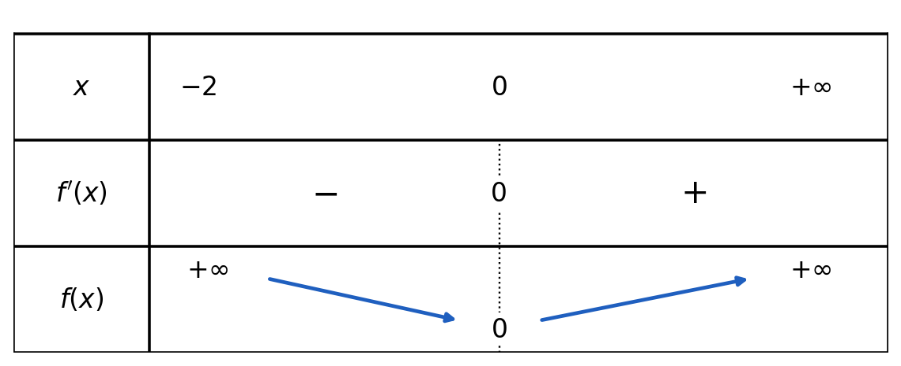
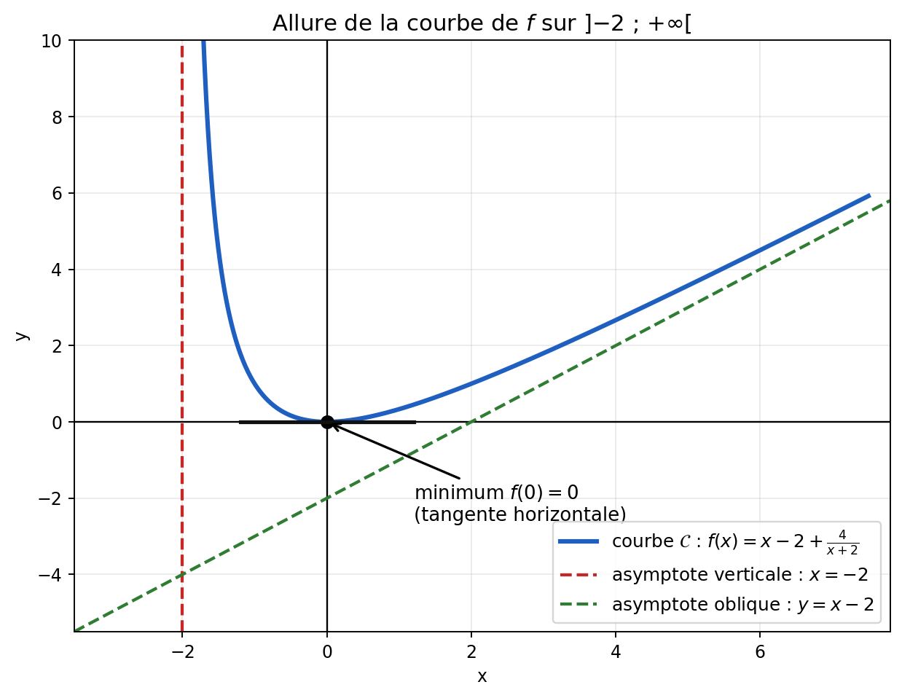

# Étude de fonctions — Domaine, parité, limites, dérivée et variations

**Matière :** Maths
**Dernière mise à jour :** 08/10/2026
**Statut :** fichier évolutif
**Important :** ce fichier utilise des images. Garde le dossier `Etudes-de-fonctions_images/` **à côté** de ce fichier `.md`.

---

## 1. Domaine de définition

L'**ensemble de définition** $D$ d'une fonction $f$ est l'ensemble des éléments $x$ de $\mathbb{R}$ qui possèdent effectivement une image par $f$ (c'est-à-dire pour lesquels le calcul de $f(x)$ est possible). On dit que $f$ est **définie sur $D$**.

Chercher un domaine de définition revient donc systématiquement à repérer les opérations "interdites" dans l'expression de $f$ : division par zéro, racine carrée d'un nombre négatif, logarithme d'un nombre négatif ou nul.

## 2. Les grandes familles de fonctions à connaître

| Type de fonction | Expression générale | Domaine de définition |
|---|---|---|
| Polynôme | $f(x) = a_n x^n + \dots + a_1 x + a_0$ | $\mathbb{R}$ (toujours défini) |
| Fonction rationnelle | $f(x) = \dfrac{P(x)}{Q(x)}$ | $\mathbb{R}$ privé des valeurs de $x$ qui annulent $Q(x)$ |
| Fonction racine carrée | $f(x) = \sqrt{x}$ | $[0\,;+\infty[$ |
| Fonction logarithme népérien | $f(x) = \ln(x)$ | $]0\,;+\infty[$ |
| Fonction exponentielle | $f(x) = e^x$ | $\mathbb{R}$ (toujours défini) |
| Fonction puissance | $f(x) = x^n$ | $\mathbb{R}$ si $n$ entier naturel ; $\mathbb{R}^*$ si $n$ entier négatif ; $[0\,;+\infty[$ si $n$ non entier |
| Fonction valeur absolue | $f(x) = \lvert x \rvert$ | $\mathbb{R}$ (toujours défini) |

**Réflexe à avoir pour une fonction composée** (ex. $\sqrt{u(x)}$, $\dfrac{1}{u(x)}$, $\ln(u(x))$) : combiner les conditions de chaque "brique" — par exemple $\sqrt{u(x)}$ exige $u(x) \ge 0$, $\dfrac{1}{u(x)}$ exige $u(x) \neq 0$, et $\ln(u(x))$ exige $u(x) > 0$.

## 3. Antécédent et image

Pour $y \in \mathbb{R}$, les **antécédents de $y$ par $f$** sont les nombres réels $x$ tels que $f(x) = y$. (Une image est unique — un $x$ donné ne donne qu'un seul $f(x)$ — mais un antécédent ne l'est pas forcément : plusieurs valeurs de $x$ peuvent donner la même image $y$.)

## 4. Parité d'une fonction

La parité d'une fonction ne peut se poser que sur un ensemble de définition **symétrique par rapport à 0** (c'est-à-dire que si $x \in D$ alors $-x \in D$ aussi) — sinon la comparaison entre $f(x)$ et $f(-x)$ n'a simplement aucun sens.

- $f$ est **paire** si, pour tout $x \in D$ : $f(-x) = f(x)$.
  *Propriété graphique* : la courbe représentative d'une fonction paire est **symétrique par rapport à l'axe des ordonnées**.
  *Exemple :* $f(x) = x^2 - 1$. On a $f(-x) = (-x)^2 - 1 = x^2 - 1 = f(x)$ → $f$ est bien paire.

- $f$ est **impaire** si, pour tout $x \in D$ : $f(-x) = -f(x)$.
  *Propriété graphique* : la courbe représentative d'une fonction impaire est **symétrique par rapport à l'origine du repère**.
  *Exemple :* $f(x) = x^3$. On a $f(-x) = (-x)^3 = -(x^3) = -f(x)$ → $f$ est bien impaire.

> **Note de Claude :** le brouillon écrivait, pour l'exemple de fonction paire, « $f(-x) = (-x)^2 - 1 = 2x^2 - 1$ » — coquille probable, puisque $(-x)^2 - 1 = x^2 - 1$ (pas $2x^2-1$), ce qui est justement ce qui prouve que $f$ est paire. Le brouillon écrivait aussi « symétrique par rapport à l'origine du **mystère** » pour la fonction impaire — vraisemblablement une coquille de frappe/dictée pour « origine du **repère** », corrigée ci-dessus.

---

## 5. Exercices résolus

### Exercice 1 — calcul d'images

Soit $f(x) = x^2 - 3x + 2$. Calculer les images de $-\frac{1}{3}$, $\frac{3}{29}$ et $-\frac{13}{5}$.

**$f(-1/3)$** :
$$f\left(-\tfrac{1}{3}\right) = \left(-\tfrac{1}{3}\right)^2 - 3\times\left(-\tfrac{1}{3}\right) + 2 = \tfrac{1}{9} + 1 + 2 = \tfrac{1}{9} + \tfrac{27}{9} = \tfrac{28}{9}$$

**$f(3/29)$** :
$$f\left(\tfrac{3}{29}\right) = \left(\tfrac{3}{29}\right)^2 - 3\times\tfrac{3}{29} + 2 = \tfrac{9}{841} - \tfrac{9}{29} + 2$$
En mettant tout au dénominateur commun 841 ($\frac{9}{29} = \frac{261}{841}$ et $2 = \frac{1682}{841}$) :
$$= \frac{9 - 261 + 1682}{841} = \frac{1430}{841} \approx 1{,}70$$

**$f(-13/5)$** :
$$f\left(-\tfrac{13}{5}\right) = \left(-\tfrac{13}{5}\right)^2 - 3\times\left(-\tfrac{13}{5}\right) + 2 = \tfrac{169}{25} + \tfrac{195}{25} + \tfrac{50}{25} = \tfrac{414}{25} = 16{,}56$$

### Exercice 2 — domaine, images, fonction réciproque

Soit $f(x) = \dfrac{x-1}{2-x}$.

**1) Domaine de définition.** Le dénominateur ne doit jamais s'annuler :
$$2 - x \neq 0 \;\Leftrightarrow\; x \neq 2 \quad\Rightarrow\quad D_f = \mathbb{R}\setminus\{2\} = \;]-\infty\,;2[\,\cup\,]2\,;+\infty[$$

> **Note de Claude :** le brouillon écrivait le premier intervalle « $]-\infty\,;-2[$ » — coquille (signe en trop devant le 2) ; la borne exclue est bien 2, pas $-2$, comme la ligne juste au-dessus (« $x \neq 2$ ») l'indique correctement.

**2) Calcul d'images :**
$$f(1) = \frac{1-1}{2-1} = \frac{0}{1} = 0$$
$$f\left(\tfrac{1}{2}\right) = \frac{0{,}5 - 1}{2 - 0{,}5} = \frac{-0{,}5}{1{,}5} = -\frac{1}{3}$$
$$f\left(-\tfrac{2}{3}\right) = \frac{-\frac{2}{3} - 1}{2-\left(-\frac{2}{3}\right)} = \frac{-\frac{5}{3}}{\frac{8}{3}} = -\frac{5}{8}$$

**3) Exprimer $x$ en fonction de $y$**, avec $y = \dfrac{x-1}{2-x}$ :
$$y(2-x) = x - 1 \;\Rightarrow\; 2y - yx = x - 1 \;\Rightarrow\; 2y + 1 = x + yx = x(1+y) \;\Rightarrow\; x = \frac{2y+1}{1+y}$$

### Exercice 3 — domaines maximaux de définition

**a)** $f(x) = \sqrt{x-4} \times \sqrt{x+6}$.
Il faut que les deux quantités sous les racines soient positives ou nulles simultanément :
$$x - 4 \ge 0 \;\text{et}\; x + 6 \ge 0 \;\Rightarrow\; x \ge 4 \;\text{et}\; x \ge -6$$
La condition la plus restrictive l'emporte (intersection des deux conditions) : $D_f = [4\,;+\infty[$.

**b)** $f(x) = \dfrac{x-5}{\sqrt{2x-4}}$.
Deux conditions à combiner : la quantité sous la racine doit être **strictement positive** (positive ou nulle ne suffit pas ici, car la racine est elle-même au dénominateur — une racine carrée de 0 donnerait une division par 0) :
$$2x - 4 > 0 \;\Rightarrow\; 2x > 4 \;\Rightarrow\; x > 2 \quad\Rightarrow\quad D_f = \,]2\,;+\infty[$$

> **Note de Claude :** le brouillon présentait cet exercice avec l'expression « $2x - 1 - 3$ » sous la racine, simplifiée en cours de route en « $2x - 4$ » (ce qui correspond bien à $2x-1-3$) — je l'ai reprise directement sous cette forme simplifiée. En revanche, l'étape suivante du brouillon contenait une erreur de calcul : « $2x - 4 > 0 \Rightarrow 2x > -4 \Rightarrow x > -2$ » — en ajoutant 4 des deux côtés de $2x-4>0$, on obtient $2x>4$ (pas $2x>-4$), donc $x>2$ (pas $x>-2$). C'est le résultat corrigé ci-dessus qu'il faut retenir.

---

## 6. Étude complète d'une fonction — Exercice 9 (08/10)

**Énoncé.** Soit la fonction $f$ définie sur $]-2\,;+\infty[$ par $f(x) = x - 2 + \dfrac{4}{x+2}$. On note $\mathcal{C}$ sa courbe représentative.

> **Note de Claude :** le brouillon écrivait « $x - 2 + 4/x + 2$ ». Vu le domaine $]-2\,;+\infty[$ (la valeur $-2$ est exclue), il s'agit bien de $\dfrac{4}{x+2}$ : le dénominateur est $x+2$.

Cet exercice utilise les outils de trois chapitres : les limites ([[Limites-de-fonctions]]), la dérivation ([[Derivation]]) et le domaine de définition (section 1 ci-dessus).

### Question 1 — Limite de $f(x) - (x-2)$ en $+\infty$

$$f(x) - (x-2) = \frac{4}{x+2} \;\xrightarrow[x \to +\infty]{}\; 0$$

**Interprétation :** la distance entre la courbe et la droite $y = x - 2$ tend vers 0. La droite d'équation $y = x - 2$ est donc une **asymptote oblique** à $\mathcal{C}$ en $+\infty$.

*Position de la courbe :* pour $x > -2$, on a $\dfrac{4}{x+2} > 0$, donc $f(x) > x - 2$ : la courbe est **au-dessus** de son asymptote.

### Question 2 — Limite de $f$ en $-2$

Quand $x$ s'approche de $-2$ **par la droite** ($x > -2$), $x + 2$ est positif et tend vers 0, donc $\dfrac{4}{x+2} \to +\infty$ (les autres termes tendent vers $-4$, un nombre fini) :
$$\lim_{x \to -2^+} f(x) = +\infty$$

**Interprétation :** la droite d'équation $x = -2$ est une **asymptote verticale** à $\mathcal{C}$.

### Question 3 — Dérivée et tableau de variations

On dérive terme à terme, avec $\left(\dfrac{4}{x+2}\right)' = -\dfrac{4}{(x+2)^2}$ :
$$f'(x) = 1 - \frac{4}{(x+2)^2} = \frac{(x+2)^2 - 4}{(x+2)^2} = \frac{x^2 + 4x}{(x+2)^2} = \frac{x(x+4)}{(x+2)^2}$$

**Signe de $f'$ sur $]-2\,;+\infty[$ :**
- $(x+2)^2 > 0$ : le dénominateur est toujours positif ;
- $x + 4 > 0$ car $x > -2 > -4$ ;
- donc $f'(x)$ a le signe de $x$ : négative sur $]-2\,;0[$, nulle en $0$, positive sur $]0\,;+\infty[$.

**Valeur au minimum :** $f(0) = 0 - 2 + \dfrac{4}{2} = 0$.

**Limite en $+\infty$ :** $f(x) \to +\infty$ (car $x - 2 \to +\infty$ et $\frac{4}{x+2} \to 0$).

La fonction $f$ est **décroissante** sur $]-2\,;0]$ puis **croissante** sur $[0\,;+\infty[$ ; elle admet un **minimum** égal à $0$, atteint en $x = 0$.

### Question 4 — Tracé de $\mathcal{C}$

Pour tracer la courbe, on utilise tous les résultats précédents :
1. on trace les deux **asymptotes** : $x = -2$ (verticale) et $y = x - 2$ (oblique) ;
2. on place le point de minimum $(0\,;0)$, où la tangente est **horizontale** ($f'(0) = 0$) ;
3. on peut ajouter quelques points pour affiner :

| $x$ | $-1{,}5$ | $-1$ | $0$ | $1$ | $2$ | $4$ | $6$ |
|---|---|---|---|---|---|---|---|
| $f(x)$ | $4{,}5$ | $1$ | $0$ | $\approx 0{,}33$ | $1$ | $\approx 2{,}67$ | $4{,}5$ |

4. on relie en respectant le comportement : la courbe "colle" à l'asymptote verticale en montant vers $+\infty$ à gauche, descend jusqu'au minimum, puis remonte en se rapprochant par le dessus de l'asymptote oblique.

**Remarque (vérification) :** en réduisant au même dénominateur, $f(x) = \dfrac{(x-2)(x+2) + 4}{x+2} = \dfrac{x^2}{x+2}$. Cette écriture confirme que $f(x) \ge 0$ sur le domaine et que $f(x) = 0$ uniquement pour $x = 0$ : c'est bien le minimum trouvé.

---

## 7. Lexique

| Terme | Définition |
|---|---|
| Domaine de définition | Ensemble des $x$ pour lesquels $f(x)$ existe |
| Antécédent | Un $x$ tel que $f(x) = y$, pour un $y$ donné |
| Fonction paire | $f(-x) = f(x)$ — courbe symétrique par rapport à l'axe des ordonnées |
| Fonction impaire | $f(-x) = -f(x)$ — courbe symétrique par rapport à l'origine du repère |
| Asymptote | Droite dont la courbe se rapproche indéfiniment |
| Tableau de variations | Tableau résumant le signe de $f'$ et le sens de variation de $f$ |
