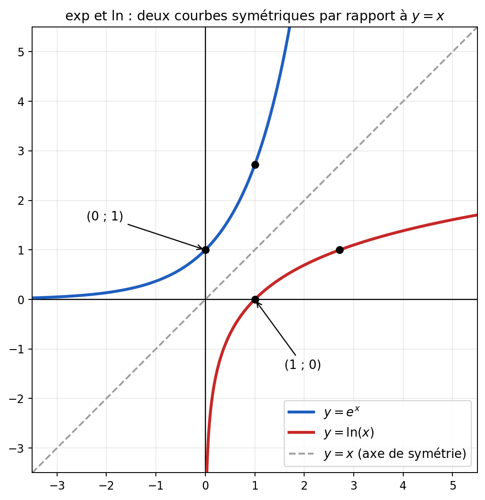

# Exponentielle et logarithme népérien — Cours

**Matière :** Maths
**Dernière mise à jour :** 08/10/2026
**Statut :** fichier évolutif — à compléter à chaque nouveau cours
**Important :** ce fichier utilise une image. Garde le dossier `Exponentielle-et-Logarithme_images/` **à côté** de ce fichier `.md`.

---

## 1. La fonction exponentielle

La fonction exponentielle est définie par $f(x) = e^x$ (où $e \approx 2{,}718$ est une constante mathématique). Elle est définie pour **tous** les réels :
$$D_f = \,]-\infty\,;+\infty[\, = \mathbb{R}$$
Elle ne prend que des valeurs **strictement positives** : $e^x > 0$ pour tout $x$.

### Les propriétés à connaître

| Propriété | Formule |
|---|---|
| Valeur en 0 | $e^0 = 1$ |
| Exposant négatif | $e^{-a} = \dfrac{1}{e^a}$ |
| Produit | $e^a \times e^b = e^{a+b}$ |
| Quotient | $\dfrac{e^a}{e^b} = e^{a-b}$ |
| Puissance | $(e^a)^n = e^{a \times n}$ |

**Moyen mnémotechnique :** l'exponentielle transforme les **additions** d'exposants en **multiplications** de valeurs ($e^{a+b} = e^a \times e^b$).

## 2. La fonction logarithme népérien

Le logarithme népérien, noté $\ln$, est défini par $f(x) = \ln(x)$ pour $x$ **strictement positif** :
$$D_f = \,]0\,;+\infty[$$

> **Note de Claude :** le brouillon écrivait « $x \in\, ]0\,;+\infty[$ donc $x \in \mathbb{R}_+$ ». Précision utile : $0$ est **exclu** (on ne peut pas calculer $\ln(0)$), il faut donc noter $\mathbb{R}_+^*$ (réels strictement positifs), et non $\mathbb{R}_+$ qui inclurait 0.

### Limites aux bornes

$$\lim_{x \to 0^+} \ln(x) = -\infty \qquad\qquad \lim_{x \to +\infty} \ln(x) = +\infty$$
*(Comme $\ln$ n'existe que pour $x > 0$, quand on dit « $x \to 0$ », on s'approche de 0 **par la droite**, c'est ce que note $0^+$. Voir aussi [[Limites-de-fonctions]].)*

### Les propriétés à connaître

| Propriété | Formule |
|---|---|
| Valeur en 1 | $\ln(1) = 0$ |
| Produit | $\ln(a \times b) = \ln(a) + \ln(b)$ |
| Quotient | $\ln\left(\dfrac{a}{b}\right) = \ln(a) - \ln(b)$ |
| Inverse | $\ln\left(\dfrac{1}{a}\right) = -\ln(a)$ |
| Puissance | $\ln(a^n) = n \times \ln(a)$ |
| Racine carrée | $\ln(\sqrt{a}) = \dfrac{1}{2}\ln(a)$ |

**Moyen mnémotechnique :** le logarithme fait l'inverse de l'exponentielle : il transforme les **multiplications** en **additions**.

> **Note de Claude :** deux formules du brouillon sont à corriger, car elles sont fausses telles qu'écrites :
> - « $\ln(a) \times \ln(b) = \ln(a+b)$ » ❌ → la bonne propriété est $\ln(a) + \ln(b) = \ln(a \times b)$ (le produit de deux logarithmes n'a pas de formule simple ; c'est la **somme** de deux logarithmes qui donne le logarithme du **produit**).
> - « $\ln(a)^n = n\ln(a)$ » ❌ → l'écriture $\ln(a)^n$ désignerait $(\ln a)^n$. La propriété correcte est $\ln(a^n) = n \ln(a)$ (l'exposant est **dans** le logarithme).
>
> Les autres formules du brouillon ($\ln(a/b) = \ln a - \ln b$, etc.) sont correctes.

## 3. Exponentielle et logarithme : deux fonctions réciproques

Les deux fonctions "s'annulent" l'une l'autre :
$$\ln(e^x) = x \quad (\text{pour tout } x \in \mathbb{R}) \qquad\qquad e^{\ln(x)} = x \quad (\text{pour tout } x > 0)$$
En particulier : $\ln(e) = 1$ et $\ln(e^a) = a$.

Graphiquement, leurs courbes sont **symétriques par rapport à la droite $y = x$** :

On y voit aussi que $e^x$ ne devient jamais négative (la courbe se rapproche de l'axe des abscisses à gauche), et que $\ln(x)$ plonge vers $-\infty$ quand $x$ s'approche de 0 (l'axe des ordonnées est une asymptote).

---

## 4. Exercice 4 — Simplifier l'écriture des expressions suivantes

**1. $\ln(e^{-1})$** : le logarithme "annule" l'exponentielle, donc $\ln(e^{-1}) = -1$.

**2. $\ln(e^{12})$** $= 12$.

**3. $\ln\left(\dfrac{1}{3}\right)$** : on utilise $\ln\left(\dfrac{a}{b}\right) = \ln a - \ln b$ :
$$\ln\left(\tfrac{1}{3}\right) = \ln(1) - \ln(3) = 0 - \ln(3) = -\ln(3)$$

**4. $\ln\left(\dfrac{1}{e^3}\right)$** :
$$\ln\left(\tfrac{1}{e^3}\right) = -\ln(e^3) = -3\ln(e) = -3 \times 1 = -3$$

**5. $\ln(\sqrt{e})$** : on écrit la racine comme une puissance, $\sqrt{e} = e^{1/2}$ :
$$\ln(\sqrt{e}) = \ln\left(e^{1/2}\right) = \tfrac{1}{2}$$

**8. $e^{-\ln(3)}$** : exposant négatif, puis exponentielle et logarithme qui s'annulent :
$$e^{-\ln(3)} = \frac{1}{e^{\ln(3)}} = \frac{1}{3}$$

**11. $e^{\frac{1}{2}\ln(3)}$** : on fait entrer le $\frac{1}{2}$ **dans** le logarithme ($n\ln a = \ln(a^n)$), puis on simplifie :
$$e^{\frac{1}{2}\ln(3)} = e^{\ln\left(3^{1/2}\right)} = 3^{1/2} = \sqrt{3}$$

> **Note de Claude :** dans le brouillon, cette dernière ligne était écrite « $e^{1/2} \times \ln(3)$ », ce qui se lit comme un produit et non comme un exposant. Le raisonnement qui suit dans le brouillon ($e^{\ln(3^{1/2})} = 3^{1/2} = \sqrt{3}$) montre que l'expression voulue est bien $e^{\frac{1}{2}\ln(3)}$ : il faut mettre des parenthèses pour que tout le $\frac{1}{2}\ln(3)$ soit en exposant.
> Les questions 6, 7, 9 et 10 de l'exercice n'apparaissaient pas dans le brouillon.

## 5. À retenir

- $e^x$ est définie sur $\mathbb{R}$ et toujours **strictement positive** ; $\ln(x)$ est définie sur $]0\,;+\infty[$.
- $\ln$ transforme produit → somme, quotient → différence, puissance → multiplication.
- $\ln(e^x) = x$ et $e^{\ln x} = x$ : réflexe n°1 pour simplifier.
- Les deux courbes sont symétriques par rapport à $y = x$.

## 6. Lexique

| Terme | Définition |
|---|---|
| $e$ | Constante mathématique, $e \approx 2{,}718$ |
| Logarithme népérien | Fonction $\ln$, réciproque de l'exponentielle |
| Fonctions réciproques | Deux fonctions qui "s'annulent" quand on les enchaîne |
