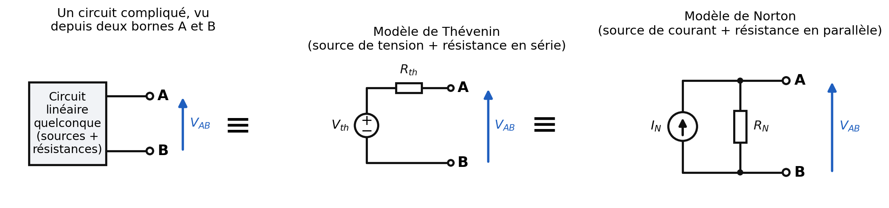
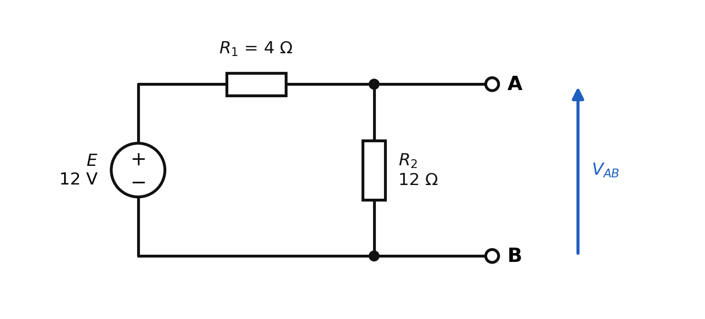
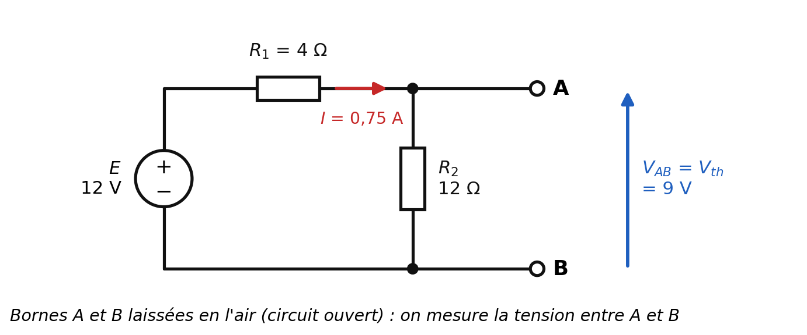
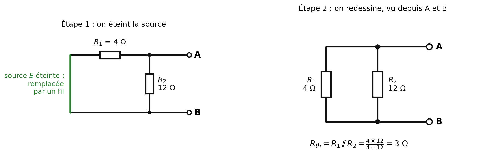
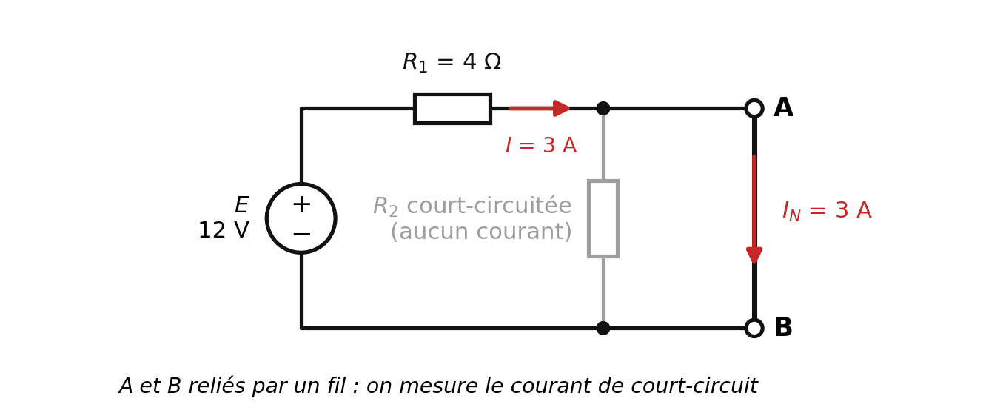
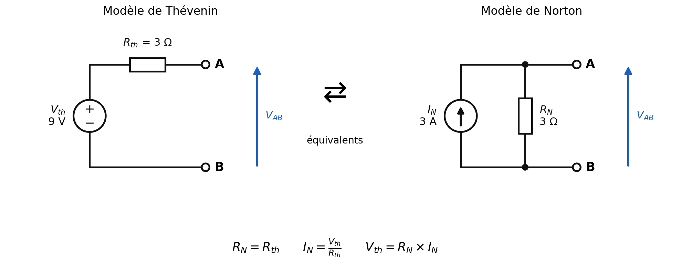
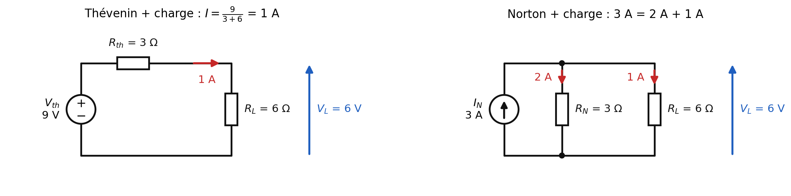

# Circuits électriques — Tension, intensité, résistances, théorèmes de Thévenin et de Norton

**Matière :** Physique
**Dernière mise à jour :** 01/10/2026
**Statut :** fichier évolutif — à compléter à chaque nouveau cours de physique sur les circuits
**Important :** ce fichier utilise des schémas. Garde le dossier `Circuits-Electriques_images/` **à côté** de ce fichier `.md` (même dossier), sinon les images ne s'afficheront pas.

---

## 0. Le vocabulaire de base, expliqué avec de l'eau

Un circuit électrique, c'est un peu comme un circuit d'eau dans des tuyaux. Cette analogie t'aidera tout au long de ce chapitre :

| Électricité | Analogie avec l'eau | Unité |
|---|---|---|
| **Tension** $U$ (ou $V$) | La **pression** de l'eau (ce qui "pousse") | le volt (V) |
| **Intensité** $I$ | Le **débit** d'eau (la quantité qui passe chaque seconde) | l'ampère (A) |
| **Résistance** $R$ | Un **rétrécissement** du tuyau (ça freine le passage) | l'ohm (Ω) |
| **Générateur** (pile, alimentation) | La **pompe** | — |

## 1. Tension et intensité électrique

- **Tension** : différence de potentiel entre les deux bornes d'un dipôle. Unité : le **volt (V)**.
- **Intensité** : débit de charges électriques dans un conducteur, c'est-à-dire la quantité de charge qui traverse une section du circuit par unité de temps :
$$I = \frac{\Delta q}{\Delta t} = \frac{q_2 - q_1}{t_2 - t_1}$$

**Pourquoi la tension est nulle aux bornes d'un simple fil conducteur ?** Un fil conducteur (idéal) ne **consomme** aucune énergie : il transporte le courant sans le transformer. La tension d'entrée du fil est donc égale à sa tension de sortie, et la **différence** de potentiel à ses bornes est nulle. Une chute de tension n'apparaît que lorsqu'un composant *consomme* de l'énergie (résistance, ampoule, moteur...).

### La loi d'Ohm (à connaître par cœur)

Pour une résistance $R$ traversée par un courant $I$, la tension à ses bornes vaut :
$$U = R \times I$$
Exemple : une résistance de 12 Ω traversée par 0,75 A a une tension de $12 \times 0{,}75 = 9$ V à ses bornes.

---

## 2. Résistance équivalente

Quand un circuit comporte plusieurs résistances, on peut les remplacer par **une seule** résistance $R_{eq}$ qui a le même effet sur le reste du circuit.

**En série** (les résistances se suivent, même courant) : on **additionne**.
$$R_{eq} = R_1 + R_2 + \dots$$

**En parallèle** (les résistances sont branchées entre les deux mêmes points, le courant se partage) : on additionne les **inverses**.
$$\frac{1}{R_{eq}} = \frac{1}{R_1} + \frac{1}{R_2} + \dots$$

**Cas particulier à deux résistances en parallèle** (très utile, on le note $R_1 \,/\!/\, R_2$) :
$$R_{eq} = \frac{R_1 \times R_2}{R_1 + R_2}$$

**Exemple résolu — trois résistances en parallèle ($R_1$, $R_1$ et $R_3$) :**
$$\frac{1}{R_{eq}} = \frac{1}{R_1} + \frac{1}{R_1} + \frac{1}{R_3} = \frac{2}{R_1} + \frac{1}{R_3} = \frac{2R_3 + R_1}{R_1 R_3} \quad\Rightarrow\quad R_{eq} = \frac{R_1 \times R_3}{2R_3 + R_1}$$

---

## 3. Deux outils supplémentaires pour la suite

### 3.1 Le diviseur de tension

Deux résistances $R_1$ et $R_2$ en série, alimentées par une tension $E$ : le même courant les traverse, $I = \dfrac{E}{R_1 + R_2}$. La tension aux bornes de $R_2$ est donc :
$$U_{R_2} = R_2 \times I = E \times \frac{R_2}{R_1 + R_2}$$
La tension $E$ se "partage" entre les deux résistances **proportionnellement à leur valeur** : la plus grosse résistance prend la plus grosse part de tension.

### 3.2 Le diviseur de courant

Deux résistances $R_a$ et $R_b$ en parallèle, traversées au total par un courant $I$ : la plus petite résistance laisse passer **plus** de courant (elle freine moins). Le courant dans $R_a$ vaut :
$$I_a = I \times \frac{R_b}{R_a + R_b}$$
*(Attention à l'inversion : c'est la résistance de **l'autre** branche qui est au numérateur.)*

### 3.3 Les deux sortes de générateurs "idéaux"

- **Source de tension idéale** : elle impose une tension fixe entre ses bornes, quel que soit le courant demandé (symbole : un cercle avec les signes + et −, on y note $E$ ou $V$).
- **Source de courant idéale** : elle impose un courant fixe dans la branche où elle se trouve, quelle que soit la tension à ses bornes (symbole : un cercle avec une flèche, on y note $I$).

Un vrai générateur (une pile, une alimentation) n'est jamais idéal : il possède toujours une petite **résistance interne**. C'est exactement ce que décrivent les modèles de Thévenin et de Norton, comme on va le voir.

---

## 4. L'idée centrale : remplacer un circuit compliqué par un circuit simple

Imagine un circuit avec plein de résistances et de générateurs, et que tu t'intéresses uniquement à ce qui se passe **entre deux points précis**, A et B (par exemple là où tu vas brancher une ampoule, un moteur, un capteur...). Tu n'as pas besoin de connaître tous les détails internes : de l'extérieur, tout ce circuit se comporte comme un petit circuit à **deux éléments seulement**. Il existe **deux** façons de dessiner ce petit circuit équivalent :

- à gauche : le circuit compliqué, vu comme une "boîte noire" avec deux bornes A et B ;
- au milieu : le **modèle de Thévenin** (une source de **tension** $V_{th}$ et une résistance $R_{th}$ en **série**) ;
- à droite : le **modèle de Norton** (une source de **courant** $I_N$ et une résistance $R_N$ en **parallèle**).

Les trois dessins sont **équivalents** : si tu branches n'importe quel composant entre A et B, il verra exactement la même tension et le même courant avec l'un ou l'autre.

---

## 5. Le théorème de Thévenin

### 5.1 Énoncé

**Tout circuit linéaire, vu depuis deux bornes A et B, peut être remplacé par une source de tension unique $V_{th}$ en série avec une résistance unique $R_{th}$.**

- $V_{th}$ (tension de Thévenin) = la tension que l'on mesure entre A et B **quand rien n'est branché** entre A et B (on dit : "à vide", ou "circuit ouvert").
- $R_{th}$ (résistance de Thévenin) = la résistance que l'on "voit" depuis A et B quand on **éteint** toutes les sources du circuit.

### 5.2 Comment "éteindre" une source ?

C'est le point où les débutants se trompent le plus souvent :

| Type de source | Comment l'éteindre | Pourquoi |
|---|---|---|
| Source de **tension** | La remplacer par un **fil** (court-circuit) | Une source de tension éteinte impose 0 V : c'est exactement ce que fait un fil |
| Source de **courant** | La **retirer** en laissant un trou (circuit ouvert) | Une source de courant éteinte impose 0 A : c'est exactement ce que fait un fil coupé |

### 5.3 Méthode en 3 étapes

1. **Repérer** les bornes A et B et **retirer** tout ce qui est branché entre elles (la charge).
2. **Calculer $V_{th}$** : tension entre A et B à vide.
3. **Calculer $R_{th}$** : éteindre les sources, puis calculer la résistance équivalente vue depuis A et B.

### 5.4 Exemple complet, pas à pas

Voici notre circuit de départ : un générateur $E = 12$ V, deux résistances $R_1 = 4$ Ω (en série) et $R_2 = 12$ Ω (qui "descend" vers le bas). Les bornes A et B sont aux points où l'on branchera plus tard un composant.

**Étape 2 — Calcul de $V_{th}$ (bornes A et B en l'air).**
Comme rien n'est branché en A-B, aucun courant n'y circule : tout le courant passe dans $R_1$ puis dans $R_2$ (elles sont en série). Le courant vaut :
$$I = \frac{E}{R_1 + R_2} = \frac{12}{4 + 12} = 0{,}75 \text{ A}$$
La tension entre A et B est celle aux bornes de $R_2$ :
$$V_{th} = V_{AB} = R_2 \times I = 12 \times 0{,}75 = 9 \text{ V}$$
*(On retrouve ce résultat avec le diviseur de tension : $12 \times \frac{12}{16} = 9$ V.)*

**Étape 3 — Calcul de $R_{th}$ (source éteinte).**
On remplace la source $E$ par un **fil** (en vert ci-dessous). Vu depuis A et B, $R_1$ et $R_2$ se retrouvent alors **en parallèle** :
$$R_{th} = R_1 \,/\!/\, R_2 = \frac{4 \times 12}{4 + 12} = \frac{48}{16} = 3 \ \Omega$$

**Résultat :** vu depuis A et B, le circuit est équivalent à une source de **9 V** en série avec une résistance de **3 Ω** (modèle de Thévenin, schéma de gauche de la section 7).

---

## 6. Le théorème de Norton

### 6.1 Énoncé

**Tout circuit linéaire, vu depuis deux bornes A et B, peut être remplacé par une source de courant unique $I_N$ en parallèle avec une résistance unique $R_N$.**

- $I_N$ (courant de Norton) = le courant qui circule entre A et B **quand on les relie par un simple fil** (on dit : courant de court-circuit).
- $R_N$ (résistance de Norton) = la résistance vue depuis A et B quand on éteint les sources. **C'est exactement la même chose que $R_{th}$.**

### 6.2 a) Comment calculer le générateur de Norton

1. **Repérer** les bornes A et B et retirer la charge.
2. **Calculer $I_N$** : relier A et B par un fil (court-circuit) et calculer le courant qui passe dans ce fil.
3. **Calculer $R_N$** : éteindre les sources (règles du 5.2) et calculer la résistance équivalente vue depuis A et B. On trouve la même valeur que $R_{th}$.
4. **Dessiner** le modèle : source de courant $I_N$ en parallèle avec $R_N$. La flèche de la source de courant pointe vers la borne A si A est la borne "+" (celle où la tension $V_{AB}$ est positive).

### 6.3 Reprise de notre exemple

**Calcul de $I_N$ (A et B reliés par un fil).**
Le fil entre A et B "court-circuite" la résistance $R_2$ : le courant préfère passer par le fil (qui n'a aucune résistance) plutôt que par $R_2$. Plus aucun courant ne passe dans $R_2$ ! Tout le courant passe dans $R_1$ puis dans le fil :
$$I_N = \frac{E}{R_1} = \frac{12}{4} = 3 \text{ A}$$

**Calcul de $R_N$.** C'est le même calcul que pour $R_{th}$ : $R_N = R_1 \,/\!/\, R_2 = 3$ Ω.

**Résultat :** vu depuis A et B, le circuit est équivalent à une source de courant de **3 A** en parallèle avec une résistance de **3 Ω**.

---

## 7. Thévenin et Norton : même circuit, deux dessins

| | Thévenin | Norton |
|---|---|---|
| Source | de **tension** $V_{th}$ | de **courant** $I_N$ |
| Résistance | en **série** avec la source | en **parallèle** avec la source |
| Comment trouver la source | tension **à vide** entre A et B | courant **de court-circuit** entre A et B |
| Valeur de la résistance | $R_{th}$ | $R_N = R_{th}$ (identique) |
| Notre exemple | 9 V et 3 Ω | 3 A et 3 Ω |
| Quand c'est pratique | circuits avec sources de tension et résistances en série | circuits avec sources de courant ou résistances en parallèle |

### Passer de l'un à l'autre

Les deux modèles décrivent le même circuit, donc on peut passer de l'un à l'autre avec ces trois formules :

$$R_N = R_{th} \qquad\qquad I_N = \frac{V_{th}}{R_{th}} \qquad\qquad V_{th} = R_N \times I_N$$

**Pourquoi ça marche ?**
- *Thévenin → Norton :* si on court-circuite A et B dans le modèle de Thévenin, la résistance $R_{th}$ est la seule à limiter le courant, donc le courant de court-circuit vaut $\dfrac{V_{th}}{R_{th}}$. C'est justement $I_N$.
- *Norton → Thévenin :* si on laisse A et B en l'air dans le modèle de Norton, tout le courant $I_N$ est obligé de passer dans $R_N$, ce qui crée à ses bornes la tension $R_N \times I_N$. C'est justement $V_{th}$.

**Exemple 1 : Thévenin → Norton.** On a $V_{th} = 10$ V et $R_{th} = 5$ Ω. Alors $I_N = \dfrac{10}{5} = 2$ A et $R_N = 5$ Ω.

**Exemple 2 : Norton → Thévenin.** On a $I_N = 4$ A et $R_N = 2$ Ω. Alors $V_{th} = 2 \times 4 = 8$ V et $R_{th} = 2$ Ω.

**Vérification avec notre exemple :** $I_N = \dfrac{9}{3} = 3$ A ✓ (on avait bien trouvé 3 A en court-circuitant A et B).

---

## 8. Vérification : brancher une charge

Branchons une résistance de charge $R_L = 6$ Ω entre A et B, d'abord sur le modèle de Thévenin, puis sur celui de Norton :

**Avec Thévenin** : on a une seule maille, $R_{th}$ et $R_L$ en série.
$$I = \frac{V_{th}}{R_{th} + R_L} = \frac{9}{3 + 6} = 1 \text{ A} \qquad V_L = R_L \times I = 6 \times 1 = 6 \text{ V}$$

**Avec Norton** : le courant $I_N = 3$ A se partage entre $R_N$ et $R_L$ (diviseur de courant, section 3.2).
$$I_L = I_N \times \frac{R_N}{R_N + R_L} = 3 \times \frac{3}{3 + 6} = 1 \text{ A} \qquad V_L = 6 \times 1 = 6 \text{ V}$$

**Les deux modèles donnent exactement le même résultat** : 1 A dans la charge, 6 V à ses bornes. C'est la preuve qu'ils sont équivalents du point de vue de la charge.

*(Petite précision utile : dans le modèle de Norton, le courant total de 3 A se répartit en 2 A dans $R_N$ et 1 A dans $R_L$. Le modèle de Thévenin ne montre pas ce détail, mais cela ne change rien pour la charge.)*

---

## 9. À quoi ça sert, concrètement ?

Si on doit étudier ce que fait le circuit pour **plusieurs charges différentes** (par exemple tester 3 ampoules différentes), on calcule **une seule fois** $V_{th}$ et $R_{th}$ (ou $I_N$ et $R_N$), puis chaque nouvelle charge se traite en une ligne de calcul. Sans le théorème, il faudrait recalculer tout le circuit à chaque fois.

---

## 10. Exercices d'entraînement (avec corrections)

**Exercice A.** Un générateur de Thévenin a $V_{th} = 24$ V et $R_{th} = 8$ Ω. Donner son modèle de Norton.
> *Correction :* $R_N = 8$ Ω et $I_N = \dfrac{24}{8} = 3$ A.

**Exercice B.** Un générateur de Norton a $I_N = 0{,}5$ A et $R_N = 100$ Ω. Donner son modèle de Thévenin.
> *Correction :* $R_{th} = 100$ Ω et $V_{th} = 100 \times 0{,}5 = 50$ V.

**Exercice C.** Un générateur $E = 10$ V est en série avec $R_1 = 2$ Ω. Puis $R_2 = 3$ Ω est branchée "vers le bas" (même schéma que notre exemple). Donner les modèles de Thévenin et de Norton vus depuis A-B.
> *Correction :*
> - $V_{th} = E \times \dfrac{R_2}{R_1 + R_2} = 10 \times \dfrac{3}{5} = 6$ V
> - $R_{th} = \dfrac{R_1 \times R_2}{R_1 + R_2} = \dfrac{2 \times 3}{5} = 1{,}2$ Ω
> - $I_N = \dfrac{E}{R_1} = \dfrac{10}{2} = 5$ A et $R_N = 1{,}2$ Ω
> - Vérification : $\dfrac{V_{th}}{R_{th}} = \dfrac{6}{1{,}2} = 5$ A ✓

---

## 11. À retenir (fiche résumé)

- **Thévenin** = source de **tension** $V_{th}$ + résistance $R_{th}$ en **série**.
- **Norton** = source de **courant** $I_N$ + résistance $R_N$ en **parallèle**.
- $V_{th}$ = tension **à vide** entre A et B. $I_N$ = courant **de court-circuit** entre A et B.
- $R_{th} = R_N$ = résistance vue de A-B avec les **sources éteintes** (source de tension → fil, source de courant → trou).
- Passage de l'un à l'autre : $I_N = \dfrac{V_{th}}{R_{th}}$ et $V_{th} = R_N \times I_N$.
- Les deux modèles donnent le **même résultat** pour n'importe quelle charge branchée entre A et B.

## 12. Lexique

| Terme | Définition |
|---|---|
| Dipôle | Composant à deux bornes (résistance, générateur, ampoule...) |
| Charge | Composant branché entre A et B, qui "consomme" ce que fournit le circuit |
| À vide | Rien n'est branché entre A et B (circuit ouvert) |
| Court-circuit | A et B reliés par un fil sans résistance |
| $V_{th}$ | Tension de Thévenin : tension à vide entre A et B |
| $R_{th}$ | Résistance de Thévenin : résistance vue de A-B, sources éteintes |
| $I_N$ | Courant de Norton : courant de court-circuit entre A et B |
| $R_N$ | Résistance de Norton : égale à $R_{th}$ |
